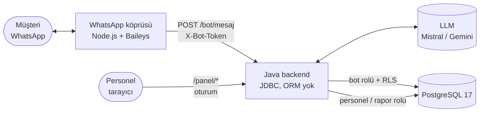

# Mini-Dealership

**Çok şubeli bir otomobil bayisi için WhatsApp randevu asistanı ve personel paneli.**

Müşteri WhatsApp'tan yazar; bot şube, müsait saat ve stok sorar, randevu alır
ya da iptal eder. Şubedeki personel aynı veriyi web panelinden yönetir:
günün randevuları, servis kayıtları, araçlar, müşteriler ve raporlar.

TOBB ETÜ **BIL372 Veritabanı Sistemleri** dönem projesidir. Projenin odağı
veritabanıdır: iş kuralları uygulama kodunda değil PostgreSQL'dedir
(`EXCLUDE` kısıtları, trigger'lar, roller ve satır düzeyi güvenlik). SQL elle
yazılır; ORM kullanılmaz.

| | |
|---|---|
| **Ekip** | Hüseyin Yiğit USTA · Şevda Yağmur ASAL |
| **Teknoloji** | PostgreSQL 17 · Java 17 (JDBC, HikariCP) · Node.js + Baileys · düz HTML/JS |
| **Veri** | 20 tablo, BCNF; ana işlem tablolarında 453.096 satır sentetik veri |
| **Test** | Gerçek PostgreSQL + gerçek JAR üzerinden otomatik DB ve HTTP test paketleri |

---

## Mimari



- **Köprü** yalnızca mesaj taşır; veritabanına dokunmaz ve iş mantığı içermez.
- **Backend** iki ayrı veritabanı bağlantısı kullanır. Bot, `bot` rolüyle
  bağlanır ve yalnızca konuştuğu müşterinin satırlarını görür (RLS). Panel,
  `NOINHERIT` bir login rolüyle bağlanır ve her istekte `SET LOCAL ROLE` ile
  `personel` ya da `rapor` rolüne geçer.
- **Kurallar veritabanında:** çakışan randevu `EXCLUDE` kısıtına, mesai,
  yetkinlik, araç sahipliği ve garanti kuralları trigger'lara takılır. Bot ve
  panel aynı kuralları paylaşır; yeni bir yazma yolu kuralları atlayamaz.
- **LLM müşteri kişisel verisi görmez.** Kimlik WhatsApp numarasından gelir,
  LLM'in ürettiği argümandan alınmaz.

## Özellikler

### WhatsApp botu
- Şube bulma, müsait saat önerisi, stoktaki ve yoldaki araçlar
- Randevu alma, listeleme ve iptal; test sürüşü, teslimat, bakım ve servis
- Mesaj kimliğiyle tekrar koruması (aynı WhatsApp mesajı iki kez işlenmez)
- LLM sağlayıcısı değiştirilebilir (`LLM_SAGLAYICI=mistral|gemini`)

### Personel paneli
- **Randevular:** şube, tür, durum ve çalışan filtresi; gün gezinme; süren
  randevu vurgusu; tamamlandı, gelmedi ve iptal işaretleme
- **Randevu ekle:** boş saat seçici; müşteri kartından tek tıkla açılır;
  telefon yerel biçimde (`0532…`) yazılabilir
- **Araçlar:** VIN/plaka arama, özellikler, garanti durumu, stok hareketleri
- **Servis kayıtları:** durum geçmişi, tahmini teslim, işlem ve masraf
  girişi, gecikenler
- **Müşteriler:** iletişim (ara, WhatsApp, kopyala), araçlar, randevu
  geçmişi, bot konuşmaları
- **Raporlar:** özet istatistikler ve tek yönlü Excel dışa aktarımı (müşteri
  adı ve telefonu maskeli)
- Menüde bugün bekleyen randevu ve geciken servis sayıları

### Veritabanı
- 20 tablo (BCNF), `GENERATED ALWAYS AS IDENTITY` anahtarlar, para tam sayı TL
- Trigger'lar: randevu doğrulama (mesai, tür saati, yetkinlik, şube), araç
  sahipliği ve servis hazırlığı, garanti ödemesi denetimi
- View'lar: müşterinin son randevusu, servis durumu, garanti durumu
  (saklanmaz, hesaplanır), maskeli rapor view'ları, bot için kişisel veri
  içermeyen dolu saatler
- Roller: `admin`, `personel`, `bot`, `rapor`; hiçbir rolde `DELETE` yok
  (iptal = durum değişikliği)
- 13 indeks ve `EXPLAIN (ANALYZE, BUFFERS)` ile ölçülmüş maliyet analizi

## Depo yapısı

| Klasör | İçerik |
|---|---|
| [`db/`](db) | Şema: tablolar, trigger'lar, view'lar, roller, RLS, indeksler. Sayı sırasıyla yüklenir (`010` → `500`) |
| [`backend/`](backend) | Java backend: bot API'si, panel API'si, LLM döngüsü |
| [`panel/`](panel) | Personel paneli (düz HTML/JS); JAR'a gömülür, backend `/` adresinden sunar |
| [`kopru/`](kopru) | WhatsApp köprüsü ([README](kopru/README.md)) |
| [`veri/`](veri) | Sentetik veri üretici (`uret.py`, yalnızca Python standart kütüphanesi) |
| [`scripts/`](scripts) | Demo, veri yükleme, test ve ölçüm betikleri |
| [`docs/api/`](docs/api) | [Bot](docs/api/bot-sozlesmesi.md) ve [panel](docs/api/panel-sozlesmesi.md) API sözleşmeleri |
| [`docs/analiz/`](docs/analiz) | Analitik sorgular ve [indeks analizi](docs/analiz/indeks-analizi.md) |
| [`docs/sema/`](docs/sema) | Şema diyagramları (tbls ile üretilir) |
| [`docs/rapor/`](docs/rapor) | Son rapor (Markdown ve LaTeX) |
| [`mini-dealership.md`](mini-dealership.md) | Proje tanımı: alan, iş kuralları, panel menüleri |

---

## Hızlı başlangıç: paneli demo veriyle açmak

**Gereksinimler:** Docker, Java 17, Python 3, `openssl`, `curl`. Betikler
POSIX `sh`'dir; Windows'ta WSL (Ubuntu) içinde çalıştırın.

```sh
scripts/panel-demo.sh
```

Betik sırasıyla şunları yapar:

1. Sentetik veriyi üretir (ilk çalıştırmada).
2. Backend'i derler (JAR yoksa).
3. Geçici bir PostgreSQL 17 konteyneri açar, şemayı ve yaklaşık 450 bin
   satırlık veriyi yükler.
4. Panel ve bot login rollerini rastgele şifrelerle oluşturur.
5. İki demo hesabına (şube 1'in bir satış ve bir servis çalışanı) şifre atar.
6. Backend'i `http://127.0.0.1:8080` adresinde başlatır.

Kullanıcı adları ve şifre ekrana yazılır. **Ctrl+C** ile durur; konteyner
ve içindeki veri silinir.

| Değişken | Açıklama |
|---|---|
| `PANEL_DEMO_SIFRE` | Demo hesaplarının şifresi; verilmezse rastgele üretilir |
| `BIND_ADRESI` | WSL2'de Windows tarayıcısından açmak için `0.0.0.0` |
| `HTTP_PORT`, `DEMO_DB_PORT` | Varsayılan `8080`, `5438` |

```sh
BIND_ADRESI=0.0.0.0 scripts/panel-demo.sh   # WSL2 → Windows tarayıcısı
```

## Tam kurulum (bot + panel + köprü)

Hızlı başlangıçtaki gereksinimlere ek olarak `psql` istemcisi ve köprü için
Node.js gerekir.

**1. Veritabanı ve veri**

```sh
docker run -d --name md-db -e POSTGRES_PASSWORD=<şifre> -p 127.0.0.1:5437:5432 postgres:17-alpine
export PGHOST=127.0.0.1 PGPORT=5437 PGUSER=postgres PGPASSWORD=<şifre> PGDATABASE=postgres
for f in db/*.sql; do psql -v ON_ERROR_STOP=1 -q -f "$f"; done
python3 veri/uret.py          # CSV'leri veri/uretilen/ altına üretir (git'e girmez)
scripts/veri-yukle.sh         # boş şemaya tek transaction'da yükler
```

**2. Backend için login rolleri**

Grup rolleri (`bot`, `personel`, `rapor`) `NOLOGIN`'dir. Backend onlara
üye olan login rolleriyle bağlanır:

```sql
CREATE ROLE bot_app   LOGIN PASSWORD '...' IN ROLE bot;
CREATE ROLE panel_app LOGIN NOINHERIT PASSWORD '...' IN ROLE personel, rapor;
```

**3. Backend**

```sh
cp backend/.env.example backend/.env   # şifreleri, BOT_TOKEN'ı ve LLM anahtarını doldurun
(cd backend && ./mvnw -q clean package -DskipTests)
scripts/backend-calistir.sh
```

| Değişken | Zorunlu | Açıklama |
|---|---|---|
| `DB_HOST`, `DB_PORT`, `DB_NAME` | ✅ | PostgreSQL bağlantısı |
| `BOT_DB_USER`, `BOT_DB_PASS` | ✅ | `bot` rolüne üye login rolü |
| `BOT_TOKEN` | ✅ | Köprüyle paylaşılan sır, en az 32 karakter |
| `PANEL_DB_USER`, `PANEL_DB_PASS` | ❌ | Panel login rolü. Verilmezse panel kapalı kalır, bot etkilenmez |
| `PANEL_OTURUM_SANIYE` | ❌ | Panel oturum süresi (varsayılan 28800 = 8 saat) |
| `LLM_SAGLAYICI` | ❌ | `mistral` ya da `gemini` |
| `MISTRAL_API_KEY` / `GEMINI_API_KEY` | ❌ | Yoksa yalnızca `/bot/mesaj` 503 döner |
| `HTTP_PORT`, `BIND_ADRESI` | ❌ | Varsayılan `8080`, `127.0.0.1` |

Bir çalışana panel şifresi atamak için bcrypt hash'i üreten yardımcı
(şifre stdin'den okunur, komut satırına ya da geçmişe yazılmaz):

```sh
java -cp backend/target/mini-dealership-backend.jar tr.edu.etu.dealership.panel.SifreHash
```

Sağlık kontrolü: `curl http://127.0.0.1:8080/saglik`

**4. WhatsApp köprüsü**: kurulum ve eşleştirme [`kopru/README.md`](kopru/README.md)'de.

## Testler

Testler, gerçek kullanıcının eriştiği arayüzden geçer: geçici bir
PostgreSQL 17 konteyneri ve gerçek backend JAR'ına gerçek HTTP istekleri.
Mutlu yolun yanında yetki reddi, sınır değerleri, eşzamanlılık ve kişisel
verinin sızmaması da sınanır.

| Komut | Kapsam |
|---|---|
| `scripts/test-db.sh` | Trigger'lar, view'lar, roller ve RLS, müşteri izolasyonu, sahiplik |
| `scripts/test-panel-http.sh` | Giriş ve hesap kilidi, oturum, rol yetkileri, DB kural hatalarının çevrimi, eşzamanlılık, Excel'de kişisel veri, statik dosya güvenliği |
| `scripts/test-bot-http.sh` | Token, kimlik, müsaitlik, stok, randevu, LLM döngüsü (sahte LLM sunucusuyla), idempotency, eşzamanlılık |
| `cd backend && ./mvnw test` | JUnit: oturum süresi, hesap kilidi, IP penceresi |
| `cd kopru && npm test` | Köprü: JID → telefon, mesaj akışı, backend istemcisi |

Gereksinim: Docker ve Java 17.

> `test-bot-http.sh` şu an tarih hesabında BSD `date -v` kullandığı için
> yalnızca macOS'ta çalışıyor.

## Ölçüm ve diyagramlar

```sh
scripts/indeks-analiz.sh     # analitik sorguların indeksli ve indekssiz EXPLAIN ANALYZE ölçümü
scripts/sema-diyagram.sh     # docs/sema/ şema diyagramlarını yeniden üretir (tbls)
```

Sonuçlar ve yorumlar: [`docs/analiz/indeks-analizi.md`](docs/analiz/indeks-analizi.md).

## Güvenlik özeti

- Bütün SQL `PreparedStatement` ile çalışır; kullanıcı girdisi SQL metnine
  eklenmez.
- Panel şifreleri bcrypt ile saklanır. Oturum anahtarı opak ve rastgeledir.
  Art arda hatalı girişte hesap geçici olarak kilitlenir.
- Panel sıkı bir CSP başlığıyla sunulur; arayüz sunucu verisini hiçbir zaman
  HTML olarak işlemez.
- Rapor ve Excel yalnızca maskeli view'lardan okur; maskeleme uygulama
  koduna değil DB rolüne bağlıdır.
- Sırlar ortam değişkenlerindedir; `.env` dosyaları git'e girmez.
