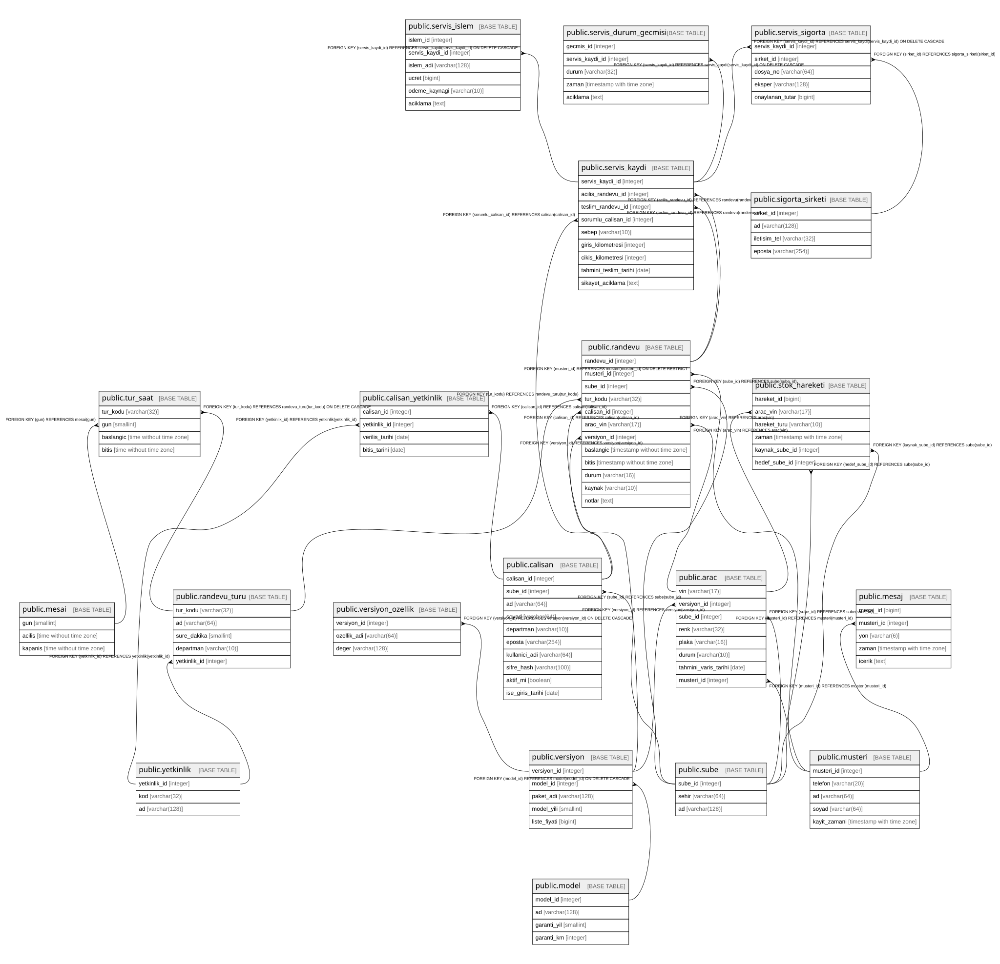

# postgres

## Tables

| Name | Columns | Comment | Type |
| ---- | ------- | ------- | ---- |
| [public.sube](public.sube.md) | 3 |  | BASE TABLE |
| [public.mesai](public.mesai.md) | 3 |  | BASE TABLE |
| [public.yetkinlik](public.yetkinlik.md) | 3 |  | BASE TABLE |
| [public.calisan](public.calisan.md) | 10 |  | BASE TABLE |
| [public.calisan_yetkinlik](public.calisan_yetkinlik.md) | 4 |  | BASE TABLE |
| [public.model](public.model.md) | 4 |  | BASE TABLE |
| [public.versiyon](public.versiyon.md) | 5 |  | BASE TABLE |
| [public.versiyon_ozellik](public.versiyon_ozellik.md) | 3 |  | BASE TABLE |
| [public.musteri](public.musteri.md) | 5 |  | BASE TABLE |
| [public.mesaj](public.mesaj.md) | 5 |  | BASE TABLE |
| [public.arac](public.arac.md) | 8 |  | BASE TABLE |
| [public.stok_hareketi](public.stok_hareketi.md) | 6 |  | BASE TABLE |

## Relations

---

> Generated by [tbls](https://github.com/k1LoW/tbls)
