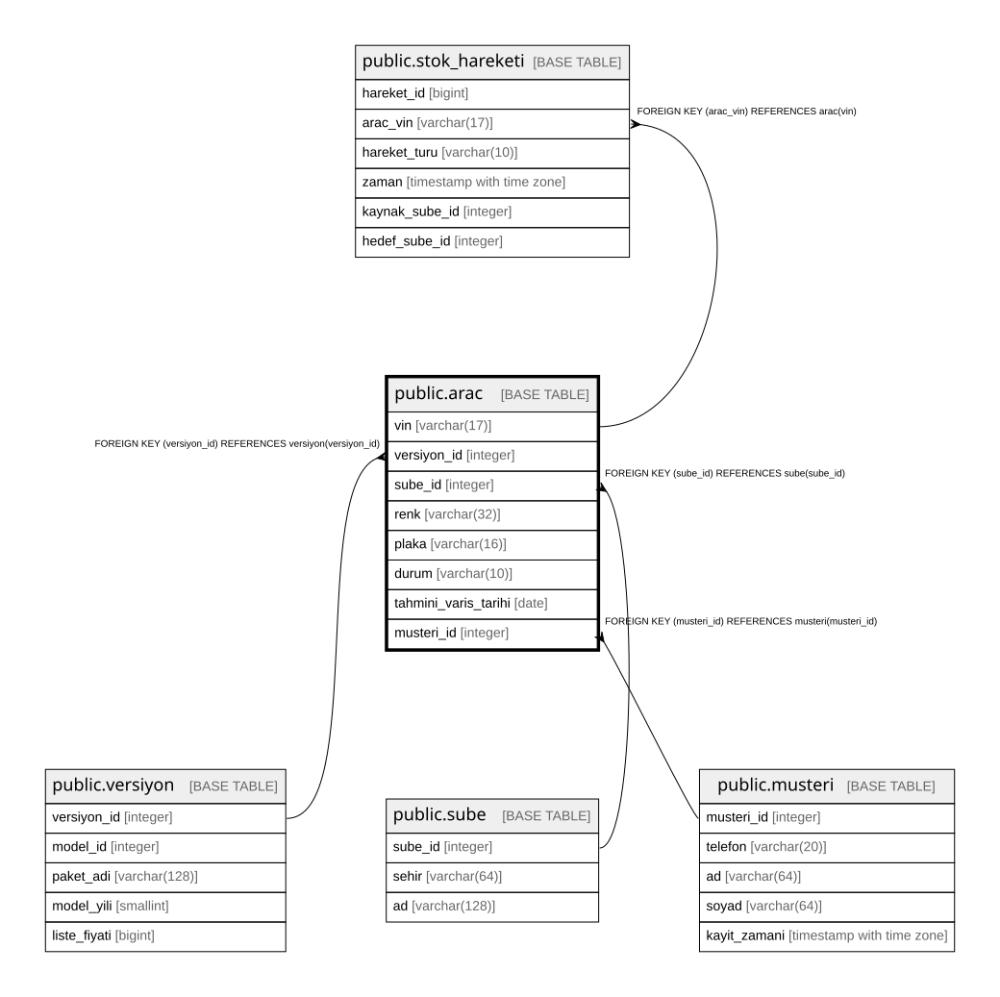

# public.arac

## Columns

| Name | Type | Default | Nullable | Children | Parents | Comment |
| ---- | ---- | ------- | -------- | -------- | ------- | ------- |
| vin | varchar(17) |  | false | [public.stok_hareketi](public.stok_hareketi.md) [public.randevu](public.randevu.md) |  |  |
| versiyon_id | integer |  | false |  | [public.versiyon](public.versiyon.md) |  |
| sube_id | integer |  | false |  | [public.sube](public.sube.md) |  |
| renk | varchar(32) |  | false |  |  |  |
| plaka | varchar(16) |  | true |  |  |  |
| durum | varchar(10) |  | false |  |  |  |
| tahmini_varis_tarihi | date |  | true |  |  |  |
| musteri_id | integer |  | true |  | [public.musteri](public.musteri.md) |  |

## Constraints

| Name | Type | Definition |
| ---- | ---- | ---------- |
| arac_check | CHECK | CHECK ((((durum)::text = 'YOLDA'::text) = (tahmini_varis_tarihi IS NOT NULL))) |
| arac_check1 | CHECK | CHECK ((((durum)::text = 'SATILDI'::text) = (musteri_id IS NOT NULL))) |
| arac_check2 | CHECK | CHECK ((((durum)::text <> 'SATILDI'::text) OR (plaka IS NOT NULL))) |
| arac_durum_check | CHECK | CHECK (((durum)::text = ANY ((ARRAY['YOLDA'::character varying, 'STOKTA'::character varying, 'SATILDI'::character varying])::text[]))) |
| arac_vin_check | CHECK | CHECK ((char_length((vin)::text) = 17)) |
| arac_sube_id_fkey | FOREIGN KEY | FOREIGN KEY (sube_id) REFERENCES sube(sube_id) |
| arac_versiyon_id_fkey | FOREIGN KEY | FOREIGN KEY (versiyon_id) REFERENCES versiyon(versiyon_id) |
| arac_musteri_id_fkey | FOREIGN KEY | FOREIGN KEY (musteri_id) REFERENCES musteri(musteri_id) |
| arac_pkey | PRIMARY KEY | PRIMARY KEY (vin) |
| arac_plaka_key | UNIQUE | UNIQUE (plaka) |

## Indexes

| Name | Definition |
| ---- | ---------- |
| arac_pkey | CREATE UNIQUE INDEX arac_pkey ON public.arac USING btree (vin) |
| arac_plaka_key | CREATE UNIQUE INDEX arac_plaka_key ON public.arac USING btree (plaka) |

## Relations

---

> Generated by [tbls](https://github.com/k1LoW/tbls)
