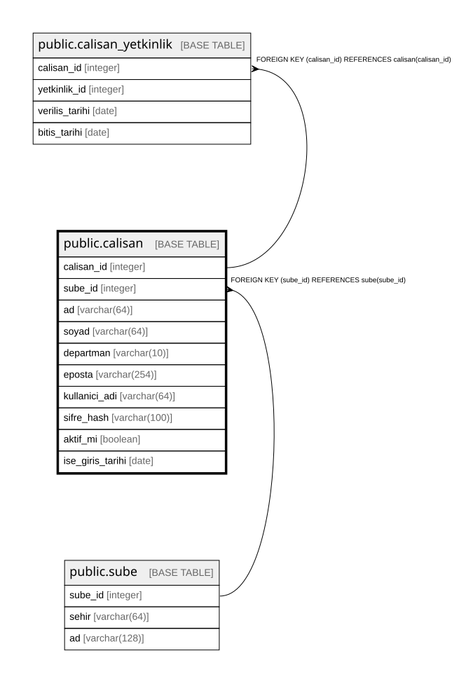

# public.calisan

## Columns

| Name | Type | Default | Nullable | Children | Parents | Comment |
| ---- | ---- | ------- | -------- | -------- | ------- | ------- |
| calisan_id | integer |  | false | [public.calisan_yetkinlik](public.calisan_yetkinlik.md) [public.randevu](public.randevu.md) [public.servis_kaydi](public.servis_kaydi.md) |  |  |
| sube_id | integer |  | false |  | [public.sube](public.sube.md) |  |
| ad | varchar(64) |  | false |  |  |  |
| soyad | varchar(64) |  | false |  |  |  |
| departman | varchar(10) |  | false |  |  |  |
| eposta | varchar(254) |  | false |  |  |  |
| kullanici_adi | varchar(64) |  | false |  |  |  |
| sifre_hash | varchar(100) |  | false |  |  |  |
| aktif_mi | boolean | true | false |  |  |  |
| ise_giris_tarihi | date |  | false |  |  |  |

## Constraints

| Name | Type | Definition |
| ---- | ---- | ---------- |
| calisan_departman_check | CHECK | CHECK (((departman)::text = ANY ((ARRAY['SATIS'::character varying, 'SERVIS'::character varying])::text[]))) |
| calisan_sube_id_fkey | FOREIGN KEY | FOREIGN KEY (sube_id) REFERENCES sube(sube_id) |
| calisan_pkey | PRIMARY KEY | PRIMARY KEY (calisan_id) |
| calisan_eposta_key | UNIQUE | UNIQUE (eposta) |
| calisan_kullanici_adi_key | UNIQUE | UNIQUE (kullanici_adi) |

## Indexes

| Name | Definition |
| ---- | ---------- |
| calisan_pkey | CREATE UNIQUE INDEX calisan_pkey ON public.calisan USING btree (calisan_id) |
| calisan_eposta_key | CREATE UNIQUE INDEX calisan_eposta_key ON public.calisan USING btree (eposta) |
| calisan_kullanici_adi_key | CREATE UNIQUE INDEX calisan_kullanici_adi_key ON public.calisan USING btree (kullanici_adi) |

## Relations

---

> Generated by [tbls](https://github.com/k1LoW/tbls)
