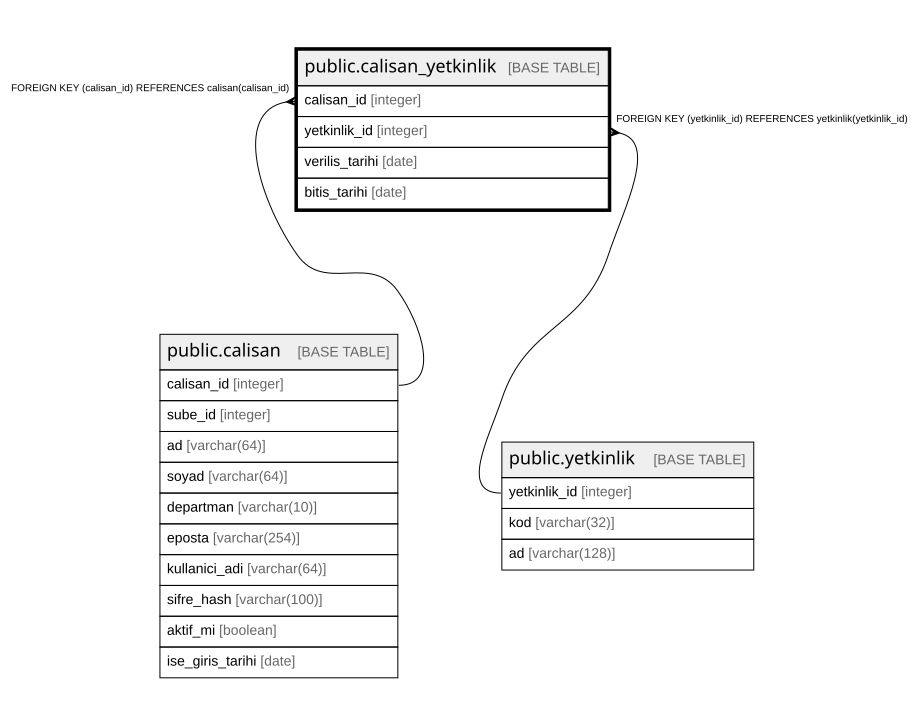

# public.calisan_yetkinlik

## Columns

| Name | Type | Default | Nullable | Children | Parents | Comment |
| ---- | ---- | ------- | -------- | -------- | ------- | ------- |
| calisan_id | integer |  | false |  | [public.calisan](public.calisan.md) |  |
| yetkinlik_id | integer |  | false |  | [public.yetkinlik](public.yetkinlik.md) |  |
| verilis_tarihi | date |  | false |  |  |  |
| bitis_tarihi | date |  | true |  |  |  |

## Constraints

| Name | Type | Definition |
| ---- | ---- | ---------- |
| calisan_yetkinlik_check | CHECK | CHECK (((bitis_tarihi IS NULL) OR (bitis_tarihi >= verilis_tarihi))) |
| calisan_yetkinlik_yetkinlik_id_fkey | FOREIGN KEY | FOREIGN KEY (yetkinlik_id) REFERENCES yetkinlik(yetkinlik_id) |
| calisan_yetkinlik_calisan_id_fkey | FOREIGN KEY | FOREIGN KEY (calisan_id) REFERENCES calisan(calisan_id) |
| calisan_yetkinlik_pkey | PRIMARY KEY | PRIMARY KEY (calisan_id, yetkinlik_id) |

## Indexes

| Name | Definition |
| ---- | ---------- |
| calisan_yetkinlik_pkey | CREATE UNIQUE INDEX calisan_yetkinlik_pkey ON public.calisan_yetkinlik USING btree (calisan_id, yetkinlik_id) |

## Relations

---

> Generated by [tbls](https://github.com/k1LoW/tbls)
