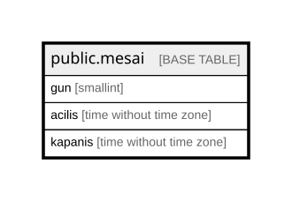

# public.mesai

## Columns

| Name | Type | Default | Nullable | Children | Parents | Comment |
| ---- | ---- | ------- | -------- | -------- | ------- | ------- |
| gun | smallint |  | false | [public.tur_saat](public.tur_saat.md) |  |  |
| acilis | time without time zone |  | false |  |  |  |
| kapanis | time without time zone |  | false |  |  |  |

## Constraints

| Name | Type | Definition |
| ---- | ---- | ---------- |
| mesai_check | CHECK | CHECK ((acilis < kapanis)) |
| mesai_gun_check | CHECK | CHECK (((gun >= 1) AND (gun <= 7))) |
| mesai_pkey | PRIMARY KEY | PRIMARY KEY (gun) |

## Indexes

| Name | Definition |
| ---- | ---------- |
| mesai_pkey | CREATE UNIQUE INDEX mesai_pkey ON public.mesai USING btree (gun) |

## Relations

---

> Generated by [tbls](https://github.com/k1LoW/tbls)
