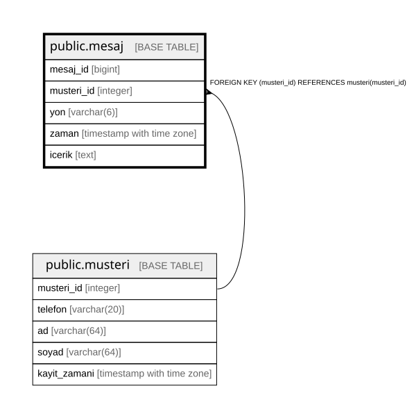

# public.mesaj

## Columns

| Name | Type | Default | Nullable | Children | Parents | Comment |
| ---- | ---- | ------- | -------- | -------- | ------- | ------- |
| mesaj_id | bigint |  | false |  |  |  |
| musteri_id | integer |  | false |  | [public.musteri](public.musteri.md) |  |
| yon | varchar(6) |  | false |  |  |  |
| zaman | timestamp with time zone | now() | false |  |  |  |
| icerik | text |  | false |  |  |  |

## Constraints

| Name | Type | Definition |
| ---- | ---- | ---------- |
| mesaj_yon_check | CHECK | CHECK (((yon)::text = ANY ((ARRAY['GELEN'::character varying, 'GIDEN'::character varying])::text[]))) |
| mesaj_musteri_id_fkey | FOREIGN KEY | FOREIGN KEY (musteri_id) REFERENCES musteri(musteri_id) |
| mesaj_pkey | PRIMARY KEY | PRIMARY KEY (mesaj_id) |

## Indexes

| Name | Definition |
| ---- | ---------- |
| mesaj_pkey | CREATE UNIQUE INDEX mesaj_pkey ON public.mesaj USING btree (mesaj_id) |

## Relations

---

> Generated by [tbls](https://github.com/k1LoW/tbls)
