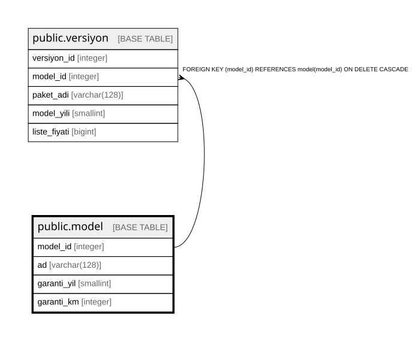

# public.model

## Columns

| Name | Type | Default | Nullable | Children | Parents | Comment |
| ---- | ---- | ------- | -------- | -------- | ------- | ------- |
| model_id | integer |  | false | [public.versiyon](public.versiyon.md) |  |  |
| ad | varchar(128) |  | false |  |  |  |
| garanti_yil | smallint |  | false |  |  |  |
| garanti_km | integer |  | false |  |  |  |

## Constraints

| Name | Type | Definition |
| ---- | ---- | ---------- |
| model_garanti_km_check | CHECK | CHECK ((garanti_km > 0)) |
| model_garanti_yil_check | CHECK | CHECK ((garanti_yil > 0)) |
| model_pkey | PRIMARY KEY | PRIMARY KEY (model_id) |
| model_ad_key | UNIQUE | UNIQUE (ad) |

## Indexes

| Name | Definition |
| ---- | ---------- |
| model_pkey | CREATE UNIQUE INDEX model_pkey ON public.model USING btree (model_id) |
| model_ad_key | CREATE UNIQUE INDEX model_ad_key ON public.model USING btree (ad) |

## Relations

---

> Generated by [tbls](https://github.com/k1LoW/tbls)
