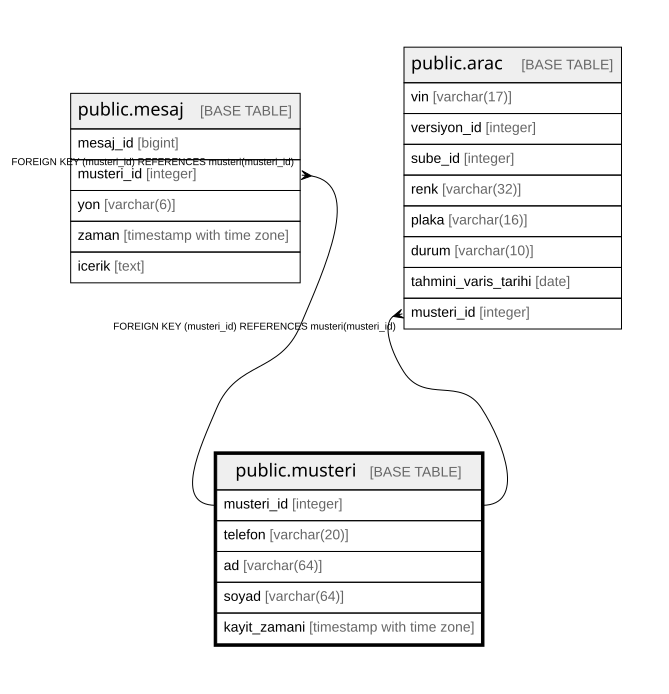

# public.musteri

## Columns

| Name | Type | Default | Nullable | Children | Parents | Comment |
| ---- | ---- | ------- | -------- | -------- | ------- | ------- |
| musteri_id | integer |  | false | [public.mesaj](public.mesaj.md) [public.arac](public.arac.md) [public.randevu](public.randevu.md) |  |  |
| telefon | varchar(20) |  | false |  |  |  |
| ad | varchar(64) |  | false |  |  |  |
| soyad | varchar(64) |  | false |  |  |  |
| kayit_zamani | timestamp with time zone | now() | false |  |  |  |

## Constraints

| Name | Type | Definition |
| ---- | ---- | ---------- |
| musteri_pkey | PRIMARY KEY | PRIMARY KEY (musteri_id) |
| musteri_telefon_key | UNIQUE | UNIQUE (telefon) |

## Indexes

| Name | Definition |
| ---- | ---------- |
| musteri_pkey | CREATE UNIQUE INDEX musteri_pkey ON public.musteri USING btree (musteri_id) |
| musteri_telefon_key | CREATE UNIQUE INDEX musteri_telefon_key ON public.musteri USING btree (telefon) |

## Relations

---

> Generated by [tbls](https://github.com/k1LoW/tbls)
