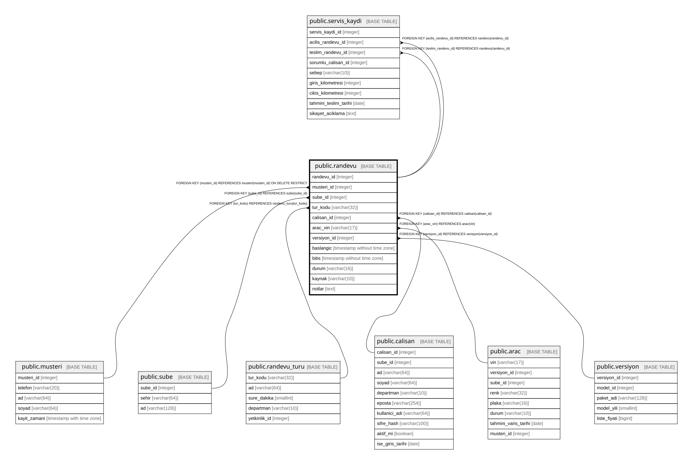

# public.randevu

## Columns

| Name | Type | Default | Nullable | Children | Parents | Comment |
| ---- | ---- | ------- | -------- | -------- | ------- | ------- |
| randevu_id | integer |  | false | [public.servis_kaydi](public.servis_kaydi.md) |  |  |
| musteri_id | integer |  | false |  | [public.musteri](public.musteri.md) |  |
| sube_id | integer |  | false |  | [public.sube](public.sube.md) |  |
| tur_kodu | varchar(32) |  | false |  | [public.randevu_turu](public.randevu_turu.md) |  |
| calisan_id | integer |  | false |  | [public.calisan](public.calisan.md) |  |
| arac_vin | varchar(17) |  | true |  | [public.arac](public.arac.md) |  |
| versiyon_id | integer |  | true |  | [public.versiyon](public.versiyon.md) |  |
| baslangic | timestamp without time zone |  | false |  |  |  |
| bitis | timestamp without time zone |  | false |  |  |  |
| durum | varchar(16) | 'PLANLANDI'::character varying | false |  |  |  |
| kaynak | varchar(10) |  | false |  |  |  |
| notlar | text |  | true |  |  |  |

## Constraints

| Name | Type | Definition |
| ---- | ---- | ---------- |
| randevu_check | CHECK | CHECK ((baslangic < bitis)) |
| randevu_check1 | CHECK | CHECK ((((tur_kodu)::text <> ALL ((ARRAY['TEST_SURUSU'::character varying, 'TESLIMAT'::character varying, 'PERIYODIK_BAKIM'::character varying, 'SERVIS_GIRIS'::character varying, 'SERVIS_TESLIM'::character varying])::text[])) OR (arac_vin IS NOT NULL))) |
| randevu_durum_check | CHECK | CHECK (((durum)::text = ANY ((ARRAY['PLANLANDI'::character varying, 'TAMAMLANDI'::character varying, 'IPTAL'::character varying, 'GELMEDI'::character varying])::text[]))) |
| randevu_kaynak_check | CHECK | CHECK (((kaynak)::text = ANY ((ARRAY['WHATSAPP'::character varying, 'PANEL'::character varying])::text[]))) |
| randevu_sube_id_fkey | FOREIGN KEY | FOREIGN KEY (sube_id) REFERENCES sube(sube_id) |
| randevu_calisan_id_fkey | FOREIGN KEY | FOREIGN KEY (calisan_id) REFERENCES calisan(calisan_id) |
| randevu_versiyon_id_fkey | FOREIGN KEY | FOREIGN KEY (versiyon_id) REFERENCES versiyon(versiyon_id) |
| randevu_musteri_id_fkey | FOREIGN KEY | FOREIGN KEY (musteri_id) REFERENCES musteri(musteri_id) ON DELETE RESTRICT |
| randevu_arac_vin_fkey | FOREIGN KEY | FOREIGN KEY (arac_vin) REFERENCES arac(vin) |
| randevu_tur_kodu_fkey | FOREIGN KEY | FOREIGN KEY (tur_kodu) REFERENCES randevu_turu(tur_kodu) |
| randevu_pkey | PRIMARY KEY | PRIMARY KEY (randevu_id) |
| randevu_calisan_id_tsrange_excl | x | EXCLUDE USING gist (calisan_id WITH =, tsrange(baslangic, bitis) WITH &&) WHERE (((durum)::text <> 'IPTAL'::text)) |
| randevu_arac_vin_tsrange_excl | x | EXCLUDE USING gist (arac_vin WITH =, tsrange(baslangic, bitis) WITH &&) WHERE (((arac_vin IS NOT NULL) AND ((durum)::text <> 'IPTAL'::text))) |
| randevu_musteri_id_tsrange_excl | x | EXCLUDE USING gist (musteri_id WITH =, tsrange(baslangic, bitis) WITH &&) WHERE (((durum)::text <> 'IPTAL'::text)) |

## Indexes

| Name | Definition |
| ---- | ---------- |
| randevu_pkey | CREATE UNIQUE INDEX randevu_pkey ON public.randevu USING btree (randevu_id) |
| randevu_calisan_id_tsrange_excl | CREATE INDEX randevu_calisan_id_tsrange_excl ON public.randevu USING gist (calisan_id, tsrange(baslangic, bitis)) WHERE ((durum)::text <> 'IPTAL'::text) |
| randevu_arac_vin_tsrange_excl | CREATE INDEX randevu_arac_vin_tsrange_excl ON public.randevu USING gist (arac_vin, tsrange(baslangic, bitis)) WHERE ((arac_vin IS NOT NULL) AND ((durum)::text <> 'IPTAL'::text)) |
| randevu_musteri_id_tsrange_excl | CREATE INDEX randevu_musteri_id_tsrange_excl ON public.randevu USING gist (musteri_id, tsrange(baslangic, bitis)) WHERE ((durum)::text <> 'IPTAL'::text) |

## Relations

---

> Generated by [tbls](https://github.com/k1LoW/tbls)
