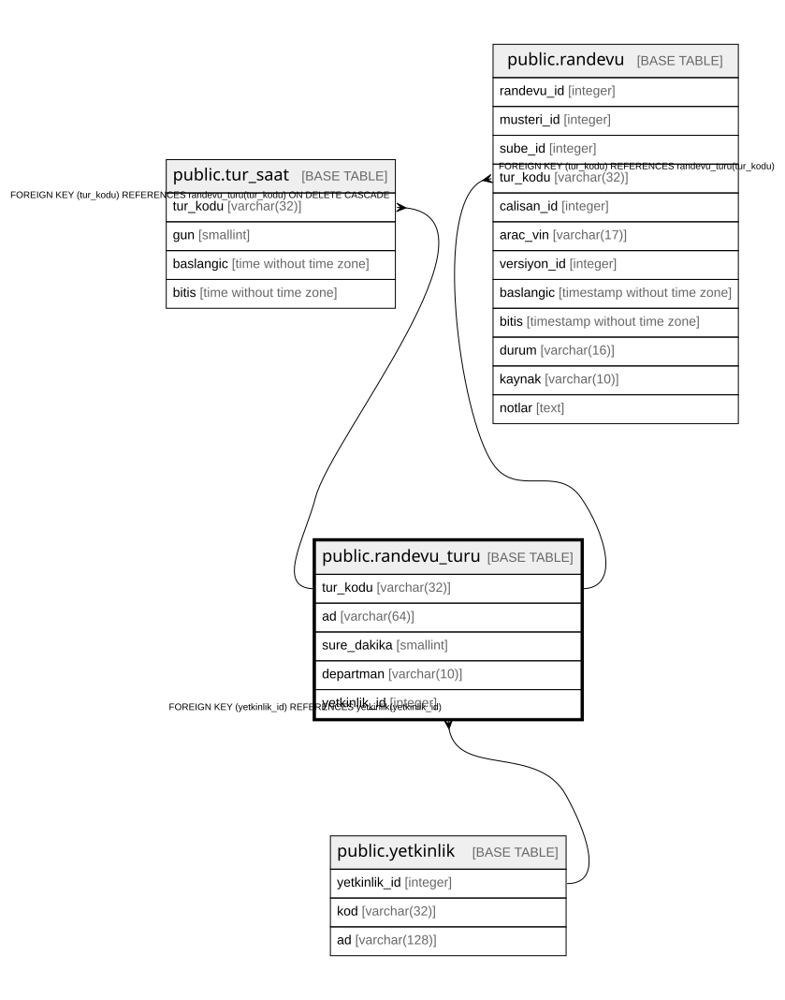

# public.randevu_turu

## Columns

| Name | Type | Default | Nullable | Children | Parents | Comment |
| ---- | ---- | ------- | -------- | -------- | ------- | ------- |
| tur_kodu | varchar(32) |  | false | [public.tur_saat](public.tur_saat.md) [public.randevu](public.randevu.md) |  |  |
| ad | varchar(64) |  | false |  |  |  |
| sure_dakika | smallint |  | false |  |  |  |
| departman | varchar(10) |  | false |  |  |  |
| yetkinlik_id | integer |  | true |  | [public.yetkinlik](public.yetkinlik.md) |  |

## Constraints

| Name | Type | Definition |
| ---- | ---- | ---------- |
| randevu_turu_departman_check | CHECK | CHECK (((departman)::text = ANY ((ARRAY['SATIS'::character varying, 'SERVIS'::character varying])::text[]))) |
| randevu_turu_sure_dakika_check | CHECK | CHECK ((sure_dakika > 0)) |
| randevu_turu_yetkinlik_id_fkey | FOREIGN KEY | FOREIGN KEY (yetkinlik_id) REFERENCES yetkinlik(yetkinlik_id) |
| randevu_turu_pkey | PRIMARY KEY | PRIMARY KEY (tur_kodu) |

## Indexes

| Name | Definition |
| ---- | ---------- |
| randevu_turu_pkey | CREATE UNIQUE INDEX randevu_turu_pkey ON public.randevu_turu USING btree (tur_kodu) |

## Relations

---

> Generated by [tbls](https://github.com/k1LoW/tbls)
