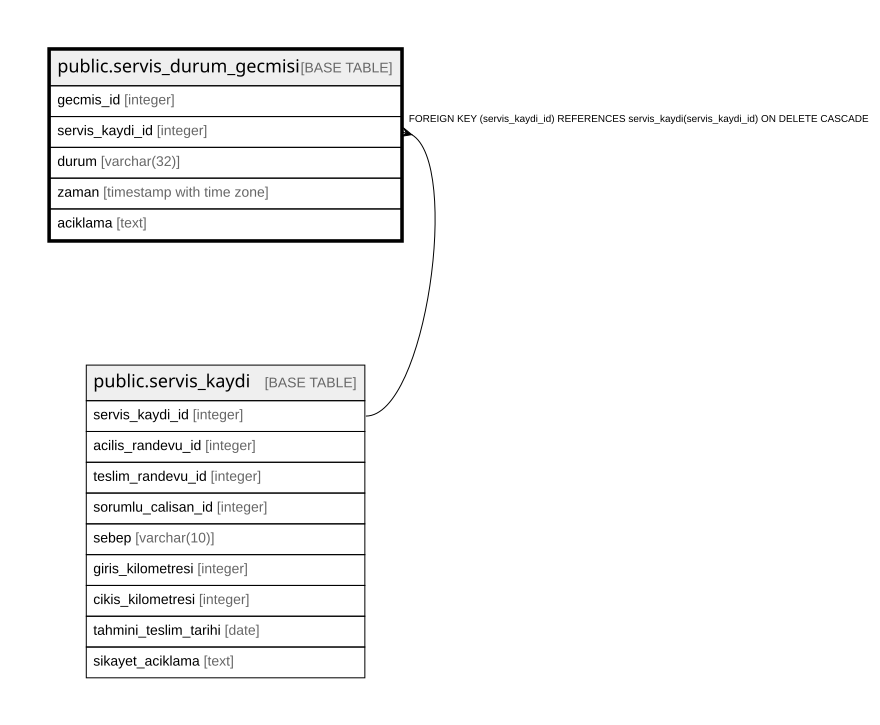

# public.servis_durum_gecmisi

## Columns

| Name | Type | Default | Nullable | Children | Parents | Comment |
| ---- | ---- | ------- | -------- | -------- | ------- | ------- |
| gecmis_id | integer |  | false |  |  |  |
| servis_kaydi_id | integer |  | false |  | [public.servis_kaydi](public.servis_kaydi.md) |  |
| durum | varchar(32) |  | false |  |  |  |
| zaman | timestamp with time zone | now() | false |  |  |  |
| aciklama | text |  | true |  |  |  |

## Constraints

| Name | Type | Definition |
| ---- | ---- | ---------- |
| servis_durum_gecmisi_durum_check | CHECK | CHECK (((durum)::text = ANY ((ARRAY['INCELENIYOR'::character varying, 'PARCA_BEKLENIYOR'::character varying, 'EKSPERTIZ_BEKLENIYOR'::character varying, 'ISLEMDE'::character varying, 'TESLIME_HAZIR'::character varying, 'TAMAMLANDI'::character varying])::text[]))) |
| servis_durum_gecmisi_servis_kaydi_id_fkey | FOREIGN KEY | FOREIGN KEY (servis_kaydi_id) REFERENCES servis_kaydi(servis_kaydi_id) ON DELETE CASCADE |
| servis_durum_gecmisi_pkey | PRIMARY KEY | PRIMARY KEY (gecmis_id) |
| servis_durum_gecmisi_servis_kaydi_id_zaman_key | UNIQUE | UNIQUE (servis_kaydi_id, zaman) |

## Indexes

| Name | Definition |
| ---- | ---------- |
| servis_durum_gecmisi_pkey | CREATE UNIQUE INDEX servis_durum_gecmisi_pkey ON public.servis_durum_gecmisi USING btree (gecmis_id) |
| servis_durum_gecmisi_servis_kaydi_id_zaman_key | CREATE UNIQUE INDEX servis_durum_gecmisi_servis_kaydi_id_zaman_key ON public.servis_durum_gecmisi USING btree (servis_kaydi_id, zaman) |

## Relations

---

> Generated by [tbls](https://github.com/k1LoW/tbls)
