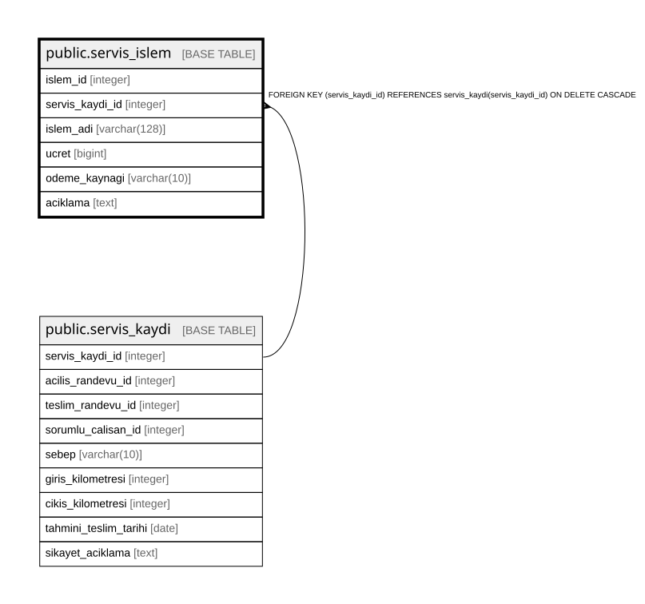

# public.servis_islem

## Columns

| Name | Type | Default | Nullable | Children | Parents | Comment |
| ---- | ---- | ------- | -------- | -------- | ------- | ------- |
| islem_id | integer |  | false |  |  |  |
| servis_kaydi_id | integer |  | false |  | [public.servis_kaydi](public.servis_kaydi.md) |  |
| islem_adi | varchar(128) |  | false |  |  |  |
| ucret | bigint |  | false |  |  |  |
| odeme_kaynagi | varchar(10) |  | false |  |  |  |
| aciklama | text |  | true |  |  |  |

## Constraints

| Name | Type | Definition |
| ---- | ---- | ---------- |
| servis_islem_odeme_kaynagi_check | CHECK | CHECK (((odeme_kaynagi)::text = ANY ((ARRAY['MUSTERI'::character varying, 'GARANTI'::character varying, 'SIGORTA'::character varying])::text[]))) |
| servis_islem_ucret_check | CHECK | CHECK ((ucret >= 0)) |
| servis_islem_servis_kaydi_id_fkey | FOREIGN KEY | FOREIGN KEY (servis_kaydi_id) REFERENCES servis_kaydi(servis_kaydi_id) ON DELETE CASCADE |
| servis_islem_pkey | PRIMARY KEY | PRIMARY KEY (islem_id) |

## Indexes

| Name | Definition |
| ---- | ---------- |
| servis_islem_pkey | CREATE UNIQUE INDEX servis_islem_pkey ON public.servis_islem USING btree (islem_id) |

## Triggers

| Name | Definition |
| ---- | ---------- |
| trg_servis_islem_garanti | CREATE TRIGGER trg_servis_islem_garanti BEFORE INSERT OR UPDATE ON public.servis_islem FOR EACH ROW EXECUTE FUNCTION fn_servis_islem_garanti_kontrol() |

## Relations

---

> Generated by [tbls](https://github.com/k1LoW/tbls)
