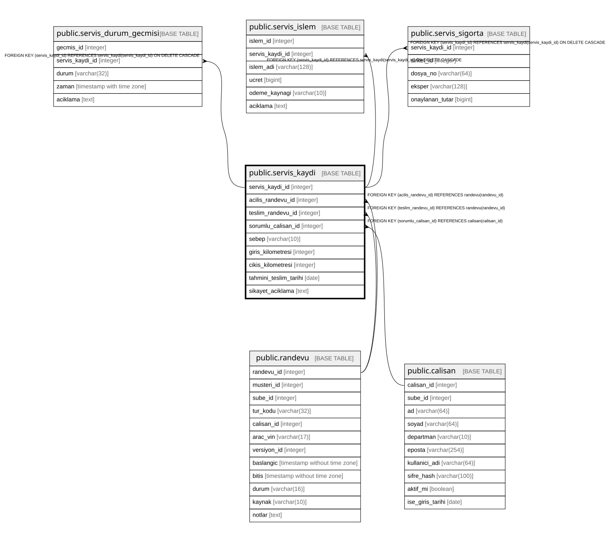

# public.servis_kaydi

## Columns

| Name | Type | Default | Nullable | Children | Parents | Comment |
| ---- | ---- | ------- | -------- | -------- | ------- | ------- |
| servis_kaydi_id | integer |  | false | [public.servis_durum_gecmisi](public.servis_durum_gecmisi.md) [public.servis_islem](public.servis_islem.md) [public.servis_sigorta](public.servis_sigorta.md) |  |  |
| acilis_randevu_id | integer |  | false |  | [public.randevu](public.randevu.md) |  |
| teslim_randevu_id | integer |  | true |  | [public.randevu](public.randevu.md) |  |
| sorumlu_calisan_id | integer |  | false |  | [public.calisan](public.calisan.md) |  |
| sebep | varchar(10) |  | false |  |  |  |
| giris_kilometresi | integer |  | false |  |  |  |
| cikis_kilometresi | integer |  | true |  |  |  |
| tahmini_teslim_tarihi | date |  | true |  |  |  |
| sikayet_aciklama | text |  | true |  |  |  |

## Constraints

| Name | Type | Definition |
| ---- | ---- | ---------- |
| servis_kaydi_check | CHECK | CHECK (((teslim_randevu_id IS NULL) OR (teslim_randevu_id <> acilis_randevu_id))) |
| servis_kaydi_check1 | CHECK | CHECK (((cikis_kilometresi IS NULL) OR (cikis_kilometresi >= giris_kilometresi))) |
| servis_kaydi_giris_kilometresi_check | CHECK | CHECK ((giris_kilometresi >= 0)) |
| servis_kaydi_sebep_check | CHECK | CHECK (((sebep)::text = ANY ((ARRAY['BAKIM'::character varying, 'ARIZA'::character varying, 'KAZA'::character varying])::text[]))) |
| servis_kaydi_sorumlu_calisan_id_fkey | FOREIGN KEY | FOREIGN KEY (sorumlu_calisan_id) REFERENCES calisan(calisan_id) |
| servis_kaydi_acilis_randevu_id_fkey | FOREIGN KEY | FOREIGN KEY (acilis_randevu_id) REFERENCES randevu(randevu_id) |
| servis_kaydi_teslim_randevu_id_fkey | FOREIGN KEY | FOREIGN KEY (teslim_randevu_id) REFERENCES randevu(randevu_id) |
| servis_kaydi_pkey | PRIMARY KEY | PRIMARY KEY (servis_kaydi_id) |
| servis_kaydi_acilis_randevu_id_key | UNIQUE | UNIQUE (acilis_randevu_id) |
| servis_kaydi_teslim_randevu_id_key | UNIQUE | UNIQUE (teslim_randevu_id) |

## Indexes

| Name | Definition |
| ---- | ---------- |
| servis_kaydi_pkey | CREATE UNIQUE INDEX servis_kaydi_pkey ON public.servis_kaydi USING btree (servis_kaydi_id) |
| servis_kaydi_acilis_randevu_id_key | CREATE UNIQUE INDEX servis_kaydi_acilis_randevu_id_key ON public.servis_kaydi USING btree (acilis_randevu_id) |
| servis_kaydi_teslim_randevu_id_key | CREATE UNIQUE INDEX servis_kaydi_teslim_randevu_id_key ON public.servis_kaydi USING btree (teslim_randevu_id) |

## Relations

---

> Generated by [tbls](https://github.com/k1LoW/tbls)
