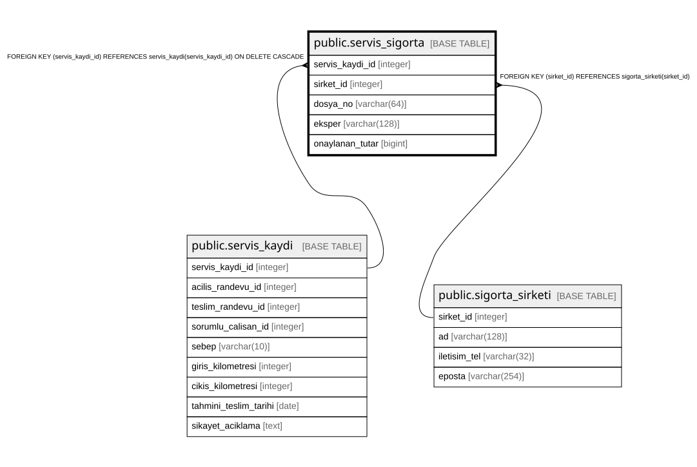

# public.servis_sigorta

## Columns

| Name | Type | Default | Nullable | Children | Parents | Comment |
| ---- | ---- | ------- | -------- | -------- | ------- | ------- |
| servis_kaydi_id | integer |  | false |  | [public.servis_kaydi](public.servis_kaydi.md) |  |
| sirket_id | integer |  | false |  | [public.sigorta_sirketi](public.sigorta_sirketi.md) |  |
| dosya_no | varchar(64) |  | false |  |  |  |
| eksper | varchar(128) |  | true |  |  |  |
| onaylanan_tutar | bigint | 0 | false |  |  |  |

## Constraints

| Name | Type | Definition |
| ---- | ---- | ---------- |
| servis_sigorta_onaylanan_tutar_check | CHECK | CHECK ((onaylanan_tutar >= 0)) |
| servis_sigorta_servis_kaydi_id_fkey | FOREIGN KEY | FOREIGN KEY (servis_kaydi_id) REFERENCES servis_kaydi(servis_kaydi_id) ON DELETE CASCADE |
| servis_sigorta_sirket_id_fkey | FOREIGN KEY | FOREIGN KEY (sirket_id) REFERENCES sigorta_sirketi(sirket_id) |
| servis_sigorta_pkey | PRIMARY KEY | PRIMARY KEY (servis_kaydi_id) |
| servis_sigorta_sirket_id_dosya_no_key | UNIQUE | UNIQUE (sirket_id, dosya_no) |

## Indexes

| Name | Definition |
| ---- | ---------- |
| servis_sigorta_pkey | CREATE UNIQUE INDEX servis_sigorta_pkey ON public.servis_sigorta USING btree (servis_kaydi_id) |
| servis_sigorta_sirket_id_dosya_no_key | CREATE UNIQUE INDEX servis_sigorta_sirket_id_dosya_no_key ON public.servis_sigorta USING btree (sirket_id, dosya_no) |

## Relations

---

> Generated by [tbls](https://github.com/k1LoW/tbls)
