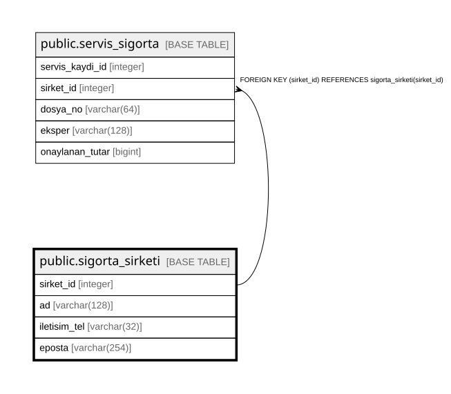

# public.sigorta_sirketi

## Columns

| Name | Type | Default | Nullable | Children | Parents | Comment |
| ---- | ---- | ------- | -------- | -------- | ------- | ------- |
| sirket_id | integer |  | false | [public.servis_sigorta](public.servis_sigorta.md) |  |  |
| ad | varchar(128) |  | false |  |  |  |
| iletisim_tel | varchar(32) |  | true |  |  |  |
| eposta | varchar(254) |  | true |  |  |  |

## Constraints

| Name | Type | Definition |
| ---- | ---- | ---------- |
| sigorta_sirketi_pkey | PRIMARY KEY | PRIMARY KEY (sirket_id) |
| sigorta_sirketi_ad_key | UNIQUE | UNIQUE (ad) |

## Indexes

| Name | Definition |
| ---- | ---------- |
| sigorta_sirketi_pkey | CREATE UNIQUE INDEX sigorta_sirketi_pkey ON public.sigorta_sirketi USING btree (sirket_id) |
| sigorta_sirketi_ad_key | CREATE UNIQUE INDEX sigorta_sirketi_ad_key ON public.sigorta_sirketi USING btree (ad) |

## Relations

---

> Generated by [tbls](https://github.com/k1LoW/tbls)
