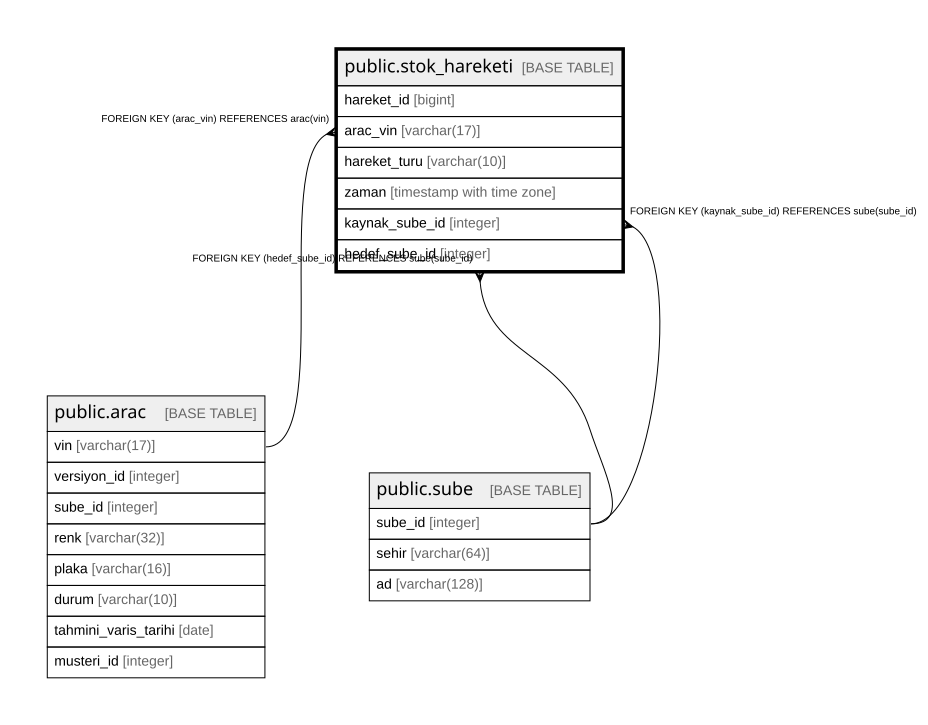

# public.stok_hareketi

## Columns

| Name | Type | Default | Nullable | Children | Parents | Comment |
| ---- | ---- | ------- | -------- | -------- | ------- | ------- |
| hareket_id | bigint |  | false |  |  |  |
| arac_vin | varchar(17) |  | false |  | [public.arac](public.arac.md) |  |
| hareket_turu | varchar(10) |  | false |  |  |  |
| zaman | timestamp with time zone | now() | false |  |  |  |
| kaynak_sube_id | integer |  | true |  | [public.sube](public.sube.md) |  |
| hedef_sube_id | integer |  | true |  | [public.sube](public.sube.md) |  |

## Constraints

| Name | Type | Definition |
| ---- | ---- | ---------- |
| stok_hareketi_check | CHECK | CHECK ((((hareket_turu)::text <> 'TRANSFER'::text) OR ((kaynak_sube_id IS NOT NULL) AND (hedef_sube_id IS NOT NULL) AND (kaynak_sube_id <> hedef_sube_id)))) |
| stok_hareketi_check1 | CHECK | CHECK ((((hareket_turu)::text <> ALL ((ARRAY['SIPARIS'::character varying, 'GELIS'::character varying])::text[])) OR ((kaynak_sube_id IS NULL) AND (hedef_sube_id IS NOT NULL)))) |
| stok_hareketi_check2 | CHECK | CHECK ((((hareket_turu)::text <> 'SATIS'::text) OR ((kaynak_sube_id IS NOT NULL) AND (hedef_sube_id IS NULL)))) |
| stok_hareketi_hareket_turu_check | CHECK | CHECK (((hareket_turu)::text = ANY ((ARRAY['SIPARIS'::character varying, 'GELIS'::character varying, 'TRANSFER'::character varying, 'SATIS'::character varying])::text[]))) |
| stok_hareketi_hedef_sube_id_fkey | FOREIGN KEY | FOREIGN KEY (hedef_sube_id) REFERENCES sube(sube_id) |
| stok_hareketi_kaynak_sube_id_fkey | FOREIGN KEY | FOREIGN KEY (kaynak_sube_id) REFERENCES sube(sube_id) |
| stok_hareketi_arac_vin_fkey | FOREIGN KEY | FOREIGN KEY (arac_vin) REFERENCES arac(vin) |
| stok_hareketi_pkey | PRIMARY KEY | PRIMARY KEY (hareket_id) |

## Indexes

| Name | Definition |
| ---- | ---------- |
| stok_hareketi_pkey | CREATE UNIQUE INDEX stok_hareketi_pkey ON public.stok_hareketi USING btree (hareket_id) |

## Relations

---

> Generated by [tbls](https://github.com/k1LoW/tbls)
