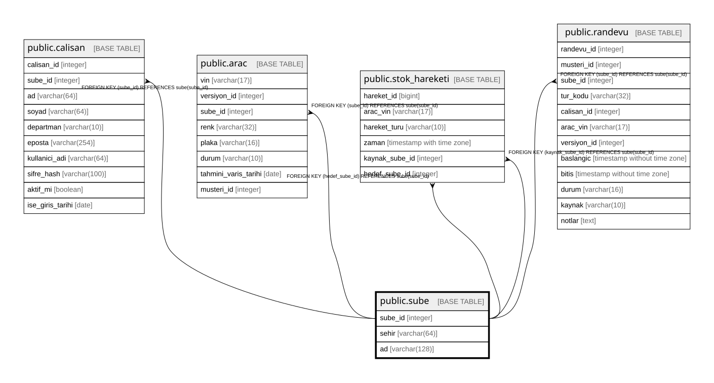

# public.sube

## Columns

| Name | Type | Default | Nullable | Children | Parents | Comment |
| ---- | ---- | ------- | -------- | -------- | ------- | ------- |
| sube_id | integer |  | false | [public.calisan](public.calisan.md) [public.arac](public.arac.md) [public.stok_hareketi](public.stok_hareketi.md) [public.randevu](public.randevu.md) |  |  |
| sehir | varchar(64) |  | false |  |  |  |
| ad | varchar(128) |  | false |  |  |  |

## Constraints

| Name | Type | Definition |
| ---- | ---- | ---------- |
| sube_pkey | PRIMARY KEY | PRIMARY KEY (sube_id) |
| sube_sehir_ad_key | UNIQUE | UNIQUE (sehir, ad) |

## Indexes

| Name | Definition |
| ---- | ---------- |
| sube_pkey | CREATE UNIQUE INDEX sube_pkey ON public.sube USING btree (sube_id) |
| sube_sehir_ad_key | CREATE UNIQUE INDEX sube_sehir_ad_key ON public.sube USING btree (sehir, ad) |

## Relations

---

> Generated by [tbls](https://github.com/k1LoW/tbls)
