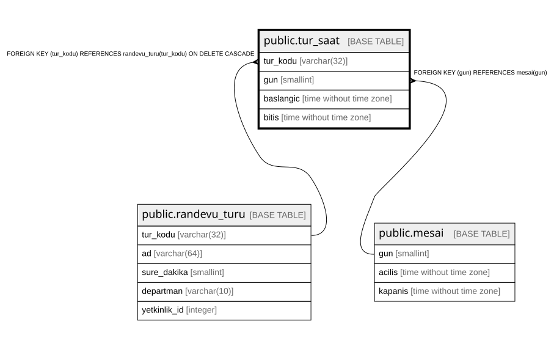

# public.tur_saat

## Columns

| Name | Type | Default | Nullable | Children | Parents | Comment |
| ---- | ---- | ------- | -------- | -------- | ------- | ------- |
| tur_kodu | varchar(32) |  | false |  | [public.randevu_turu](public.randevu_turu.md) |  |
| gun | smallint |  | false |  | [public.mesai](public.mesai.md) |  |
| baslangic | time without time zone |  | false |  |  |  |
| bitis | time without time zone |  | false |  |  |  |

## Constraints

| Name | Type | Definition |
| ---- | ---- | ---------- |
| tur_saat_check | CHECK | CHECK ((baslangic < bitis)) |
| tur_saat_gun_fkey | FOREIGN KEY | FOREIGN KEY (gun) REFERENCES mesai(gun) |
| tur_saat_tur_kodu_fkey | FOREIGN KEY | FOREIGN KEY (tur_kodu) REFERENCES randevu_turu(tur_kodu) ON DELETE CASCADE |
| tur_saat_pkey | PRIMARY KEY | PRIMARY KEY (tur_kodu, gun, baslangic) |

## Indexes

| Name | Definition |
| ---- | ---------- |
| tur_saat_pkey | CREATE UNIQUE INDEX tur_saat_pkey ON public.tur_saat USING btree (tur_kodu, gun, baslangic) |

## Relations

---

> Generated by [tbls](https://github.com/k1LoW/tbls)
