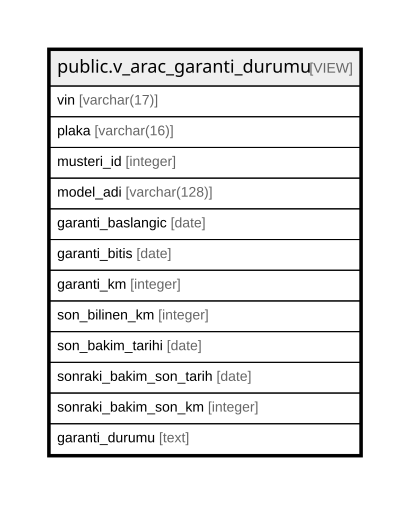

# public.v_arac_garanti_durumu

## Description

<details>
<summary><strong>Table Definition</strong></summary>

```sql
CREATE VIEW v_arac_garanti_durumu AS (
 WITH satis AS (
         SELECT stok_hareketi.arac_vin,
            (min(stok_hareketi.zaman))::timestamp without time zone AS satis_zamani
           FROM stok_hareketi
          WHERE ((stok_hareketi.hareket_turu)::text = 'SATIS'::text)
          GROUP BY stok_hareketi.arac_vin
        ), gecerli_servis AS (
         SELECT r.arac_vin,
            r.baslangic,
            sk.giris_kilometresi AS km,
            sk.sebep
           FROM (servis_kaydi sk
             JOIN randevu r ON ((r.randevu_id = sk.acilis_randevu_id)))
          WHERE (((r.durum)::text <> ALL ((ARRAY['IPTAL'::character varying, 'GELMEDI'::character varying])::text[])) AND (r.baslangic <= LOCALTIMESTAMP))
        ), bakim_zinciri AS (
         SELECT satis.arac_vin,
            satis.satis_zamani AS zaman,
            0 AS km
           FROM satis
        UNION ALL
         SELECT g.arac_vin,
            g.baslangic,
            g.km
           FROM (gecerli_servis g
             JOIN satis s_1 ON (((s_1.arac_vin)::text = (g.arac_vin)::text)))
          WHERE (((g.sebep)::text = 'BAKIM'::text) AND (g.baslangic >= s_1.satis_zamani))
        ), bakim_araliklari AS (
         SELECT bakim_zinciri.arac_vin,
            bakim_zinciri.zaman,
            bakim_zinciri.km,
            lag(bakim_zinciri.zaman) OVER w AS onceki_zaman,
            lag(bakim_zinciri.km) OVER w AS onceki_km
           FROM bakim_zinciri
          WINDOW w AS (PARTITION BY bakim_zinciri.arac_vin ORDER BY bakim_zinciri.zaman)
        ), bakim_ozet AS (
         SELECT bakim_araliklari.arac_vin,
            max(bakim_araliklari.zaman) AS son_bakim_zamani,
            (array_agg(bakim_araliklari.km ORDER BY bakim_araliklari.zaman DESC))[1] AS son_bakim_km,
            COALESCE(bool_or(((bakim_araliklari.zaman > (bakim_araliklari.onceki_zaman + '1 year'::interval)) OR ((bakim_araliklari.km - bakim_araliklari.onceki_km) > 15000))), false) AS gecmiste_aksatildi
           FROM bakim_araliklari
          GROUP BY bakim_araliklari.arac_vin
        ), son_km AS (
         SELECT g.arac_vin,
            max(g.km) AS son_bilinen_km
           FROM gecerli_servis g
          GROUP BY g.arac_vin
        )
 SELECT a.vin,
    a.plaka,
    a.musteri_id,
    m.ad AS model_adi,
    (s.satis_zamani)::date AS garanti_baslangic,
    ((s.satis_zamani + make_interval(years => (m.garanti_yil)::integer)))::date AS garanti_bitis,
    m.garanti_km,
    COALESCE(k.son_bilinen_km, 0) AS son_bilinen_km,
    (b.son_bakim_zamani)::date AS son_bakim_tarihi,
    ((b.son_bakim_zamani + '1 year'::interval))::date AS sonraki_bakim_son_tarih,
    (b.son_bakim_km + 15000) AS sonraki_bakim_son_km,
        CASE
            WHEN (LOCALTIMESTAMP > (s.satis_zamani + make_interval(years => (m.garanti_yil)::integer))) THEN 'SURE_DOLDU'::text
            WHEN (COALESCE(k.son_bilinen_km, 0) > m.garanti_km) THEN 'KM_ASILDI'::text
            WHEN (b.gecmiste_aksatildi OR (LOCALTIMESTAMP > (b.son_bakim_zamani + '1 year'::interval)) OR ((COALESCE(k.son_bilinen_km, 0) - b.son_bakim_km) > 15000)) THEN 'BAKIM_AKSATILDI'::text
            ELSE 'GECERLI'::text
        END AS garanti_durumu
   FROM (((((arac a
     JOIN satis s ON (((s.arac_vin)::text = (a.vin)::text)))
     JOIN versiyon v ON ((v.versiyon_id = a.versiyon_id)))
     JOIN model m ON ((m.model_id = v.model_id)))
     JOIN bakim_ozet b ON (((b.arac_vin)::text = (a.vin)::text)))
     LEFT JOIN son_km k ON (((k.arac_vin)::text = (a.vin)::text)))
)
```

</details>

## Columns

| Name | Type | Default | Nullable | Children | Parents | Comment |
| ---- | ---- | ------- | -------- | -------- | ------- | ------- |
| vin | varchar(17) |  | true |  |  |  |
| plaka | varchar(16) |  | true |  |  |  |
| musteri_id | integer |  | true |  |  |  |
| model_adi | varchar(128) |  | true |  |  |  |
| garanti_baslangic | date |  | true |  |  |  |
| garanti_bitis | date |  | true |  |  |  |
| garanti_km | integer |  | true |  |  |  |
| son_bilinen_km | integer |  | true |  |  |  |
| son_bakim_tarihi | date |  | true |  |  |  |
| sonraki_bakim_son_tarih | date |  | true |  |  |  |
| sonraki_bakim_son_km | integer |  | true |  |  |  |
| garanti_durumu | text |  | true |  |  |  |

## Referenced Tables

| Name | Columns | Comment | Type |
| ---- | ------- | ------- | ---- |
| [public.stok_hareketi](public.stok_hareketi.md) | 6 |  | BASE TABLE |
| [public.servis_kaydi](public.servis_kaydi.md) | 9 |  | BASE TABLE |
| [public.randevu](public.randevu.md) | 12 |  | BASE TABLE |
| [gecerli_servis](gecerli_servis.md) | 0 |  |  |
| [bakim_zinciri](bakim_zinciri.md) | 0 |  |  |
| [bakim_araliklari](bakim_araliklari.md) | 0 |  |  |
| [public.arac](public.arac.md) | 8 |  | BASE TABLE |
| [public.versiyon](public.versiyon.md) | 5 |  | BASE TABLE |
| [public.model](public.model.md) | 4 |  | BASE TABLE |
| [bakim_ozet](bakim_ozet.md) | 0 |  |  |
| [son_km](son_km.md) | 0 |  |  |

## Relations



---

> Generated by [tbls](https://github.com/k1LoW/tbls)
