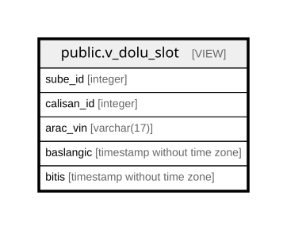

# public.v_dolu_slot

## Description

<details>
<summary><strong>Table Definition</strong></summary>

```sql
CREATE VIEW v_dolu_slot AS (
 SELECT sube_id,
    calisan_id,
    arac_vin,
    baslangic,
    bitis
   FROM randevu r
  WHERE ((durum)::text <> 'IPTAL'::text)
)
```

</details>

## Columns

| Name | Type | Default | Nullable | Children | Parents | Comment |
| ---- | ---- | ------- | -------- | -------- | ------- | ------- |
| sube_id | integer |  | true |  |  |  |
| calisan_id | integer |  | true |  |  |  |
| arac_vin | varchar(17) |  | true |  |  |  |
| baslangic | timestamp without time zone |  | true |  |  |  |
| bitis | timestamp without time zone |  | true |  |  |  |

## Referenced Tables

| Name | Columns | Comment | Type |
| ---- | ------- | ------- | ---- |
| [public.randevu](public.randevu.md) | 12 |  | BASE TABLE |

## Relations



---

> Generated by [tbls](https://github.com/k1LoW/tbls)
