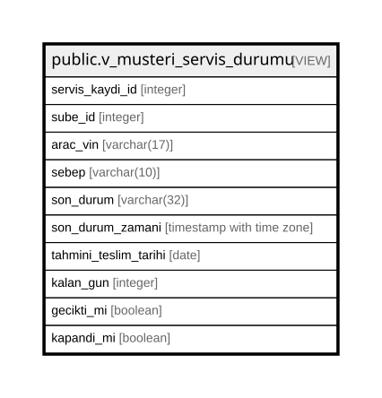

# public.v_musteri_servis_durumu

## Description

Bot için müşteriye özel servis durumu: masraf ve çalışan bilgisi içermez, yalnızca konuşulan müşterinin satırlarını gösterir.

<details>
<summary><strong>Table Definition</strong></summary>

```sql
CREATE VIEW v_musteri_servis_durumu AS (
 SELECT servis_kaydi_id,
    sube_id,
    arac_vin,
    sebep,
    son_durum,
    son_durum_zamani,
    tahmini_teslim_tarihi,
    kalan_gun,
    gecikti_mi,
    kapandi_mi
   FROM v_servis_durumu sd
  WHERE (musteri_id = fn_aktif_musteri_id())
)
```

</details>

## Columns

| Name | Type | Default | Nullable | Children | Parents | Comment |
| ---- | ---- | ------- | -------- | -------- | ------- | ------- |
| servis_kaydi_id | integer |  | true |  |  |  |
| sube_id | integer |  | true |  |  |  |
| arac_vin | varchar(17) |  | true |  |  |  |
| sebep | varchar(10) |  | true |  |  |  |
| son_durum | varchar(32) |  | true |  |  |  |
| son_durum_zamani | timestamp with time zone |  | true |  |  |  |
| tahmini_teslim_tarihi | date |  | true |  |  |  |
| kalan_gun | integer |  | true |  |  |  |
| gecikti_mi | boolean |  | true |  |  |  |
| kapandi_mi | boolean |  | true |  |  |  |

## Referenced Tables

| Name | Columns | Comment | Type |
| ---- | ------- | ------- | ---- |
| [public.v_servis_durumu](public.v_servis_durumu.md) | 18 |  | VIEW |

## Relations



---

> Generated by [tbls](https://github.com/k1LoW/tbls)
