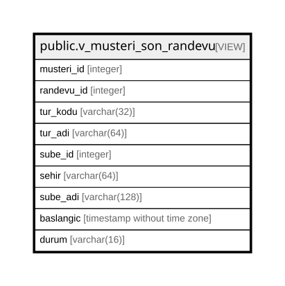

# public.v_musteri_son_randevu

## Description

<details>
<summary><strong>Table Definition</strong></summary>

```sql
CREATE VIEW v_musteri_son_randevu AS (
 SELECT DISTINCT ON (r.musteri_id) r.musteri_id,
    r.randevu_id,
    r.tur_kodu,
    rt.ad AS tur_adi,
    r.sube_id,
    s.sehir,
    s.ad AS sube_adi,
    r.baslangic,
    r.durum
   FROM ((randevu r
     JOIN randevu_turu rt ON (((rt.tur_kodu)::text = (r.tur_kodu)::text)))
     JOIN sube s ON ((s.sube_id = r.sube_id)))
  WHERE ((r.durum)::text <> 'IPTAL'::text)
  ORDER BY r.musteri_id, r.baslangic DESC, r.randevu_id DESC
)
```

</details>

## Columns

| Name | Type | Default | Nullable | Children | Parents | Comment |
| ---- | ---- | ------- | -------- | -------- | ------- | ------- |
| musteri_id | integer |  | true |  |  |  |
| randevu_id | integer |  | true |  |  |  |
| tur_kodu | varchar(32) |  | true |  |  |  |
| tur_adi | varchar(64) |  | true |  |  |  |
| sube_id | integer |  | true |  |  |  |
| sehir | varchar(64) |  | true |  |  |  |
| sube_adi | varchar(128) |  | true |  |  |  |
| baslangic | timestamp without time zone |  | true |  |  |  |
| durum | varchar(16) |  | true |  |  |  |

## Referenced Tables

| Name | Columns | Comment | Type |
| ---- | ------- | ------- | ---- |
| [public.randevu](public.randevu.md) | 12 |  | BASE TABLE |
| [public.randevu_turu](public.randevu_turu.md) | 5 |  | BASE TABLE |
| [public.sube](public.sube.md) | 3 |  | BASE TABLE |

## Relations



---

> Generated by [tbls](https://github.com/k1LoW/tbls)
