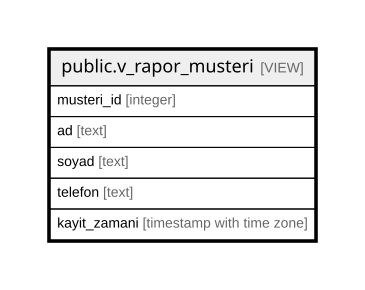

# public.v_rapor_musteri

## Description

<details>
<summary><strong>Table Definition</strong></summary>

```sql
CREATE VIEW v_rapor_musteri AS (
 SELECT musteri_id,
    fn_maskele_ad((ad)::text) AS ad,
    fn_maskele_ad((soyad)::text) AS soyad,
    fn_maskele_telefon((telefon)::text) AS telefon,
    kayit_zamani
   FROM musteri mu
)
```

</details>

## Columns

| Name | Type | Default | Nullable | Children | Parents | Comment |
| ---- | ---- | ------- | -------- | -------- | ------- | ------- |
| musteri_id | integer |  | true |  |  |  |
| ad | text |  | true |  |  |  |
| soyad | text |  | true |  |  |  |
| telefon | text |  | true |  |  |  |
| kayit_zamani | timestamp with time zone |  | true |  |  |  |

## Referenced Tables

| Name | Columns | Comment | Type |
| ---- | ------- | ------- | ---- |
| [public.musteri](public.musteri.md) | 5 |  | BASE TABLE |

## Relations



---

> Generated by [tbls](https://github.com/k1LoW/tbls)
