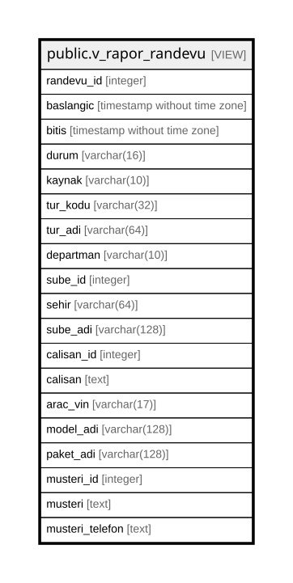

# public.v_rapor_randevu

## Description

<details>
<summary><strong>Table Definition</strong></summary>

```sql
CREATE VIEW v_rapor_randevu AS (
 SELECT r.randevu_id,
    r.baslangic,
    r.bitis,
    r.durum,
    r.kaynak,
    r.tur_kodu,
    rt.ad AS tur_adi,
    rt.departman,
    s.sube_id,
    s.sehir,
    s.ad AS sube_adi,
    c.calisan_id,
    (((c.ad)::text || ' '::text) || (c.soyad)::text) AS calisan,
    r.arac_vin,
    mo.ad AS model_adi,
    ve.paket_adi,
    r.musteri_id,
    ((fn_maskele_ad((mu.ad)::text) || ' '::text) || fn_maskele_ad((mu.soyad)::text)) AS musteri,
    fn_maskele_telefon((mu.telefon)::text) AS musteri_telefon
   FROM (((((((randevu r
     JOIN randevu_turu rt ON (((rt.tur_kodu)::text = (r.tur_kodu)::text)))
     JOIN sube s ON ((s.sube_id = r.sube_id)))
     JOIN calisan c ON ((c.calisan_id = r.calisan_id)))
     JOIN musteri mu ON ((mu.musteri_id = r.musteri_id)))
     LEFT JOIN arac a ON (((a.vin)::text = (r.arac_vin)::text)))
     LEFT JOIN versiyon ve ON ((ve.versiyon_id = COALESCE(a.versiyon_id, r.versiyon_id))))
     LEFT JOIN model mo ON ((mo.model_id = ve.model_id)))
)
```

</details>

## Columns

| Name | Type | Default | Nullable | Children | Parents | Comment |
| ---- | ---- | ------- | -------- | -------- | ------- | ------- |
| randevu_id | integer |  | true |  |  |  |
| baslangic | timestamp without time zone |  | true |  |  |  |
| bitis | timestamp without time zone |  | true |  |  |  |
| durum | varchar(16) |  | true |  |  |  |
| kaynak | varchar(10) |  | true |  |  |  |
| tur_kodu | varchar(32) |  | true |  |  |  |
| tur_adi | varchar(64) |  | true |  |  |  |
| departman | varchar(10) |  | true |  |  |  |
| sube_id | integer |  | true |  |  |  |
| sehir | varchar(64) |  | true |  |  |  |
| sube_adi | varchar(128) |  | true |  |  |  |
| calisan_id | integer |  | true |  |  |  |
| calisan | text |  | true |  |  |  |
| arac_vin | varchar(17) |  | true |  |  |  |
| model_adi | varchar(128) |  | true |  |  |  |
| paket_adi | varchar(128) |  | true |  |  |  |
| musteri_id | integer |  | true |  |  |  |
| musteri | text |  | true |  |  |  |
| musteri_telefon | text |  | true |  |  |  |

## Referenced Tables

| Name | Columns | Comment | Type |
| ---- | ------- | ------- | ---- |
| [public.randevu](public.randevu.md) | 12 |  | BASE TABLE |
| [public.randevu_turu](public.randevu_turu.md) | 5 |  | BASE TABLE |
| [public.sube](public.sube.md) | 3 |  | BASE TABLE |
| [public.calisan](public.calisan.md) | 10 |  | BASE TABLE |
| [public.musteri](public.musteri.md) | 5 |  | BASE TABLE |
| [public.arac](public.arac.md) | 8 |  | BASE TABLE |
| [public.versiyon](public.versiyon.md) | 5 |  | BASE TABLE |
| [public.model](public.model.md) | 4 |  | BASE TABLE |

## Relations



---

> Generated by [tbls](https://github.com/k1LoW/tbls)
