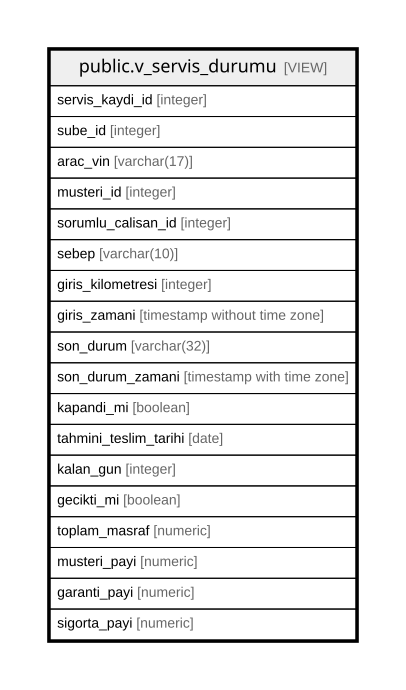

# public.v_servis_durumu

## Description

<details>
<summary><strong>Table Definition</strong></summary>

```sql
CREATE VIEW v_servis_durumu AS (
 SELECT sk.servis_kaydi_id,
    r.sube_id,
    r.arac_vin,
    r.musteri_id,
    sk.sorumlu_calisan_id,
    sk.sebep,
    sk.giris_kilometresi,
    r.baslangic AS giris_zamani,
    son.durum AS son_durum,
    son.zaman AS son_durum_zamani,
    ((sk.teslim_randevu_id IS NOT NULL) OR (NOT ((son.durum)::text IS DISTINCT FROM 'TAMAMLANDI'::text))) AS kapandi_mi,
    sk.tahmini_teslim_tarihi,
    (sk.tahmini_teslim_tarihi - CURRENT_DATE) AS kalan_gun,
    (COALESCE((sk.tahmini_teslim_tarihi < CURRENT_DATE), false) AND (sk.teslim_randevu_id IS NULL) AND ((son.durum)::text IS DISTINCT FROM 'TAMAMLANDI'::text)) AS gecikti_mi,
    COALESCE(m.toplam_masraf, (0)::numeric) AS toplam_masraf,
    COALESCE(m.musteri_payi, (0)::numeric) AS musteri_payi,
    COALESCE(m.garanti_payi, (0)::numeric) AS garanti_payi,
    COALESCE(m.sigorta_payi, (0)::numeric) AS sigorta_payi
   FROM (((servis_kaydi sk
     JOIN randevu r ON ((r.randevu_id = sk.acilis_randevu_id)))
     LEFT JOIN LATERAL ( SELECT g.durum,
            g.zaman
           FROM servis_durum_gecmisi g
          WHERE (g.servis_kaydi_id = sk.servis_kaydi_id)
          ORDER BY g.zaman DESC
         LIMIT 1) son ON (true))
     LEFT JOIN LATERAL ( SELECT sum(i.ucret) AS toplam_masraf,
            sum(i.ucret) FILTER (WHERE ((i.odeme_kaynagi)::text = 'MUSTERI'::text)) AS musteri_payi,
            sum(i.ucret) FILTER (WHERE ((i.odeme_kaynagi)::text = 'GARANTI'::text)) AS garanti_payi,
            sum(i.ucret) FILTER (WHERE ((i.odeme_kaynagi)::text = 'SIGORTA'::text)) AS sigorta_payi
           FROM servis_islem i
          WHERE (i.servis_kaydi_id = sk.servis_kaydi_id)) m ON (true))
)
```

</details>

## Columns

| Name | Type | Default | Nullable | Children | Parents | Comment |
| ---- | ---- | ------- | -------- | -------- | ------- | ------- |
| servis_kaydi_id | integer |  | true |  |  |  |
| sube_id | integer |  | true |  |  |  |
| arac_vin | varchar(17) |  | true |  |  |  |
| musteri_id | integer |  | true |  |  |  |
| sorumlu_calisan_id | integer |  | true |  |  |  |
| sebep | varchar(10) |  | true |  |  |  |
| giris_kilometresi | integer |  | true |  |  |  |
| giris_zamani | timestamp without time zone |  | true |  |  |  |
| son_durum | varchar(32) |  | true |  |  |  |
| son_durum_zamani | timestamp with time zone |  | true |  |  |  |
| kapandi_mi | boolean |  | true |  |  |  |
| tahmini_teslim_tarihi | date |  | true |  |  |  |
| kalan_gun | integer |  | true |  |  |  |
| gecikti_mi | boolean |  | true |  |  |  |
| toplam_masraf | numeric |  | true |  |  |  |
| musteri_payi | numeric |  | true |  |  |  |
| garanti_payi | numeric |  | true |  |  |  |
| sigorta_payi | numeric |  | true |  |  |  |

## Referenced Tables

| Name | Columns | Comment | Type |
| ---- | ------- | ------- | ---- |
| ['TAMAMLANDI'::text]('TAMAMLANDI'::text.md) | 0 |  |  |
| [public.servis_kaydi](public.servis_kaydi.md) | 9 |  | BASE TABLE |
| [public.randevu](public.randevu.md) | 12 |  | BASE TABLE |
| [LATERAL](LATERAL.md) | 0 |  |  |
| [public.servis_durum_gecmisi](public.servis_durum_gecmisi.md) | 5 |  | BASE TABLE |
| [public.servis_islem](public.servis_islem.md) | 6 |  | BASE TABLE |

## Relations



---

> Generated by [tbls](https://github.com/k1LoW/tbls)
