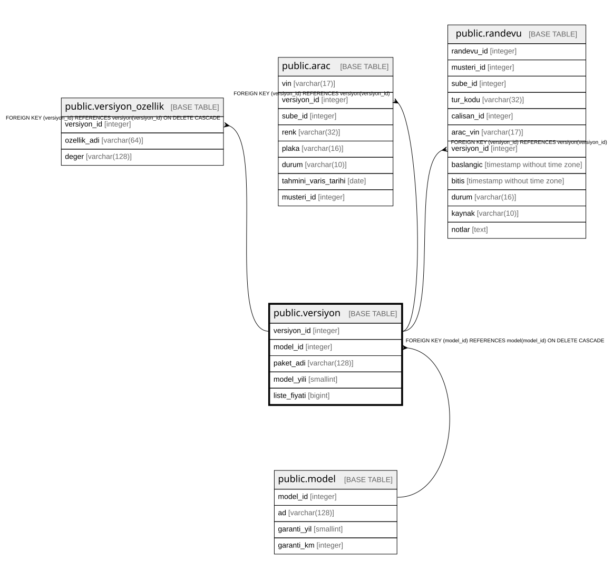

# public.versiyon

## Columns

| Name | Type | Default | Nullable | Children | Parents | Comment |
| ---- | ---- | ------- | -------- | -------- | ------- | ------- |
| versiyon_id | integer |  | false | [public.versiyon_ozellik](public.versiyon_ozellik.md) [public.arac](public.arac.md) [public.randevu](public.randevu.md) |  |  |
| model_id | integer |  | false |  | [public.model](public.model.md) |  |
| paket_adi | varchar(128) |  | false |  |  |  |
| model_yili | smallint |  | false |  |  |  |
| liste_fiyati | bigint |  | false |  |  |  |

## Constraints

| Name | Type | Definition |
| ---- | ---- | ---------- |
| versiyon_liste_fiyati_check | CHECK | CHECK ((liste_fiyati >= 0)) |
| versiyon_model_yili_check | CHECK | CHECK ((model_yili >= 1950)) |
| versiyon_model_id_fkey | FOREIGN KEY | FOREIGN KEY (model_id) REFERENCES model(model_id) ON DELETE CASCADE |
| versiyon_pkey | PRIMARY KEY | PRIMARY KEY (versiyon_id) |
| versiyon_model_id_paket_adi_model_yili_key | UNIQUE | UNIQUE (model_id, paket_adi, model_yili) |

## Indexes

| Name | Definition |
| ---- | ---------- |
| versiyon_pkey | CREATE UNIQUE INDEX versiyon_pkey ON public.versiyon USING btree (versiyon_id) |
| versiyon_model_id_paket_adi_model_yili_key | CREATE UNIQUE INDEX versiyon_model_id_paket_adi_model_yili_key ON public.versiyon USING btree (model_id, paket_adi, model_yili) |

## Relations

---

> Generated by [tbls](https://github.com/k1LoW/tbls)
