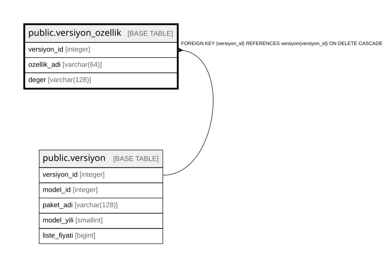

# public.versiyon_ozellik

## Columns

| Name | Type | Default | Nullable | Children | Parents | Comment |
| ---- | ---- | ------- | -------- | -------- | ------- | ------- |
| versiyon_id | integer |  | false |  | [public.versiyon](public.versiyon.md) |  |
| ozellik_adi | varchar(64) |  | false |  |  |  |
| deger | varchar(128) |  | false |  |  |  |

## Constraints

| Name | Type | Definition |
| ---- | ---- | ---------- |
| versiyon_ozellik_versiyon_id_fkey | FOREIGN KEY | FOREIGN KEY (versiyon_id) REFERENCES versiyon(versiyon_id) ON DELETE CASCADE |
| versiyon_ozellik_pkey | PRIMARY KEY | PRIMARY KEY (versiyon_id, ozellik_adi) |

## Indexes

| Name | Definition |
| ---- | ---------- |
| versiyon_ozellik_pkey | CREATE UNIQUE INDEX versiyon_ozellik_pkey ON public.versiyon_ozellik USING btree (versiyon_id, ozellik_adi) |

## Relations

---

> Generated by [tbls](https://github.com/k1LoW/tbls)
