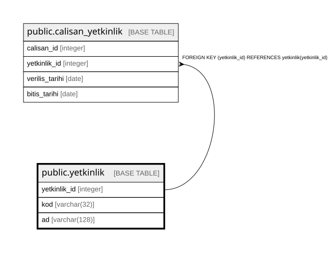

# public.yetkinlik

## Columns

| Name | Type | Default | Nullable | Children | Parents | Comment |
| ---- | ---- | ------- | -------- | -------- | ------- | ------- |
| yetkinlik_id | integer |  | false | [public.calisan_yetkinlik](public.calisan_yetkinlik.md) [public.randevu_turu](public.randevu_turu.md) |  |  |
| kod | varchar(32) |  | false |  |  |  |
| ad | varchar(128) |  | false |  |  |  |

## Constraints

| Name | Type | Definition |
| ---- | ---- | ---------- |
| yetkinlik_pkey | PRIMARY KEY | PRIMARY KEY (yetkinlik_id) |
| yetkinlik_kod_key | UNIQUE | UNIQUE (kod) |

## Indexes

| Name | Definition |
| ---- | ---------- |
| yetkinlik_pkey | CREATE UNIQUE INDEX yetkinlik_pkey ON public.yetkinlik USING btree (yetkinlik_id) |
| yetkinlik_kod_key | CREATE UNIQUE INDEX yetkinlik_kod_key ON public.yetkinlik USING btree (kod) |

## Relations

---

> Generated by [tbls](https://github.com/k1LoW/tbls)
